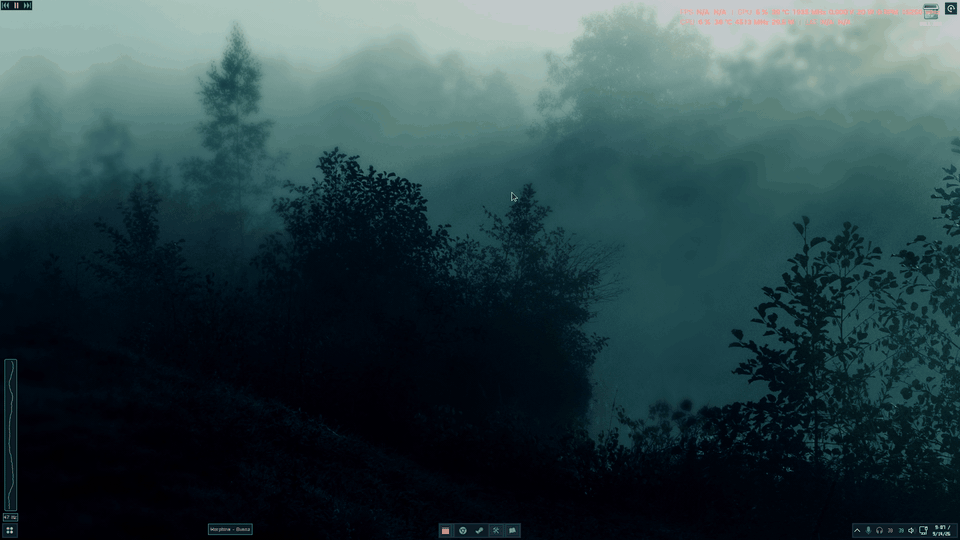

# Tourne'Style - Cogs in the shell

Linux-level customizing for Windows, with no phoning home. Everything I've made, in one place: **Tourne Desktop**, every **Windhawk mod** (latest versions only), the **icon packs**, the **Tourne'Table community styles**, and the devlogs that explain how it all got here.

| | What it is | Where |

|---|---|---|

| **Tourne Desktop** | The taskbar, Start menu, switcher with tiling, system icons and flyouts, Studio, plugins and the built-in Tourne'Table, as one program. On my PC it runs as the Windows shell. | [`tourne-desktop/`](tourne-desktop/) |

| **Windhawk mods** | 17 mods: the Tourne'Suite (all hook parts in one), Tourne'Table 2.1, Tourne'Icons, Tourne Menus, and the standalones. | [`windhawk-mods/`](windhawk-mods/) |

| **Icon packs** | The complete ink pack (add-ons folded in), the UI vector icons, the red and green pack, the pixel tray icons, Start orbs. | [`icon-packs/`](icon-packs/) |

| **Community styles** | Tourne'Table styles people share, with a gallery and a bot that takes them in. | [`community/`](community/) |

| **Devlogs** | The story of how it was built, from the first build to now. | [`devlogs/`](devlogs/) |

## Discord

[Join the Tourne'Style Discord](https://discord.gg/5JsHEMBxvY). It's my hub for everything here: share your Tourne'Table styles, icon packs, plugins and setups, see what's coming in the roadmap, devlogs and releases, get help, report bugs, suggest ideas, and test builds before they're out. When you join, pick what you use to get release pings for it.

## Status

Everything here is a **work in progress**, shared as it runs on my own PC. Tourne'Table 2.1 is now in the official Windhawk catalog; Tourne Desktop and the suite are tested on very few PCs. Read [what Tourne Desktop needs and what can go wrong](tourne-desktop/README.md#before-you-install) before installing it, and back up first.

**What the pieces need:** Windows 11, 64-bit (24H2 or later is what it's built on). [Windhawk](https://windhawk.net) 1.7.3 or newer for every mod. StartAllBack is optional: the suite's Clock and Classic Tray Folders parts style its taskbar and do nothing without it. No Node.js anywhere; Python only for two optional plugins. Developer Mode only for Tourne Desktop's phone calls.

## Where we're going

What Tourne'Style is aiming for. These are intentions, not promises or dates.

**The idea:** Linux-level customizing for Windows (the Hyprland way of doing things: every part a switch, your own keys, rules, motion and looks), without a terminal, without anything phoning home, and cheap enough to run all day. Anything Tourne changes in Windows goes back the way it was when you turn it off.

**Next up**

- **Tourne'Table's next update.** 2.1 is in the Windhawk catalog now. The update after it, already built and in testing, adds Engine Cores (which processor cores do the work), Frame Sync (VSync, Adaptive and Fast Sync), Low Latency, and an optional x2 frame generation.

- **A newer Tourne Desktop release** with the fixes already running on my PC: startup apps in shell mode, tray icons that survive a restart, and plugins that apply their settings at once. Then a steadier Tourne Studio.

- **Shell mode without gaps:** balloon tips, and Tourne's own answers to Win+A and Win+N.

- **Icons that stay put:** Tourne'Icons Lasting keeping every icon without the live mod, an Apps folder for Store and other packaged apps, and the last icons drawn in the ink style.

- **Devices:** the GMK87 keyboard's battery, and hover tooltips in plugin panels.

**Further out**

- **Everything Hyprland does, made for Windows.** A part by part map of the Hyprland wiki is the checklist ([`research/plans`](tourne-desktop/source/research/plans/)).

- **Motion everywhere:** every part of the desktop following the same animation settings, not only the bar and borders.

- **Richer glass:** glass that bends what's behind it at its edges, and shader looks to pick from.

- **More switcher views**, such as an infinite canvas of your windows.

- **A wallpaper manager** with a library, colour filters and recolouring, all point and click.

- **More than one Tourne Menu** (the LiteMenu replacement): a menu per place, such as the desktop, the bar or a screen corner, with the switcher views as actions.

- **A panel shell look:** the bar as separate islands that can sit on any edge.

- **More plugins**, including ports from the Noctalia shell's catalogue, which uses the same Luau plugin language.

- **The community:** more shared Tourne'Table styles, and sharing for whole desktop looks the same way.

## Start here

1. **Want the whole look?** Download `tourne-desktop/release/TourneDesktop-<commit>.zip`, unzip it anywhere, run `TourneDesktop.exe`. Its tray icon opens Tourne Studio, where every part is a switch. Then add the Windhawk mods in the "Use together" list below for the parts that have to live inside Explorer.

2. **Want one piece?** Each folder in `windhawk-mods/` is one mod with its own README. In Windhawk, choose **Create a new mod**, paste the `.wh.cpp`, then **Compile mod** (Windhawk 2 also takes `windhawk-cli mod install --file <path>`).

3. **Want icons?** Install Tourne'Icons, press **Apply a pack**, and open a pack's `pack.tsv`.

## Use together

These are built to run side by side with Tourne Desktop:

| Mod | Why it's separate |

|---|---|

| [Tourne'Suite](windhawk-mods/tourne-suite/) | The parts that must hook Explorer and other programs. Tourne Desktop skips any part that's switched on in the suite, so nothing is drawn twice. |

| [Tourne Menus](windhawk-mods/tourne-menus/) | Draws File Explorer's, the file dialogs' and Windows' own menus in Tourne Desktop's look (Desktop publishes the look to `HKCU\Software\Tourne\Menus`). |

| [Tourne'Icons](windhawk-mods/tourne-icons/) | Changes any icon everywhere, picked from a tray icon. With it on, turn the suite's Icon Redirect part off. Tourne'Icons Lasting is its hook-free twin whose changes stay with the mod off, and Tourne'Icons Kit the same as a plain program. |

| [Tourne'Table](windhawk-mods/tourne-table/) | Built into Tourne Desktop already. Use the mod when you don't run Desktop's copy: Desktop leaves its own off while a Tourne'Table mod is on. |

## Standalones

Each of these also lives inside the suite as a part. Run the standalone **or** the suite's part, not both: Tourne'Tray [System Icons], Tourne'Text [System Text Color], Tourne'Tray [Change Tray Icons], Tourne'Menu [No Icons], Tourne'Menu [No Duplicates], Tourne'Tray [Classic Tray Folders], Tourne'Tray [Clock], Tourne'Icons [Icon Redirect] and Tourne'Suite Tweaks. Fully on their own: Tourne Drop Install, Tourne Mod Tray, and Hide the app icon in taskbar thumbnail previews. The full table with versions is in [`windhawk-mods/README.md`](windhawk-mods/README.md).

## Share your Tourne'Table style

Right-click the visualizer, then **My Styles > Style Editor > Community > Share Mine to the Community**. It opens an issue here with your style in it; a bot checks it and replies with a code anyone can paste to try it. Browse what's there in [`community/`](community/) or on the [gallery page](https://user-tourne.github.io/Tourne-Style/).

## What was left out on purpose

- **Older builds.** Only the newest version of each mod is here: suite b65, Tourne'Table 2.1 (2.3.0 beta beside it), Tourne'Icons 2.7.4, and so on.

- **Personal settings.** The suite and Tweaks bake my settings in as defaults; paths into my own folders and e-mail addresses were blanked, and the `.reg` exports of my own settings aren't included. Icon pack rows that only pointed at files on my PC were dropped (85 in the ink pack, 34 in the red and green pack).

- **Third-party theme files** (Bouquet, Everforest and others) aren't redistributed; the research notes that describe them are.

## Licenses

From October 29, 2026 on:

- **My code and mods** are GPL-3.0 ([`LICENSE`](LICENSE)): share a changed version and you share its source too.
- **My icons and docs** (the icon packs, the pixel and ink icons in Tourne Desktop, the devlogs, readmes and changelogs) are [CC BY-NC-SA 4.0](LICENSE-CC-BY-NC-SA-4.0.txt): use them and change them, credit me (Tourne, USER-TOURNE), don't sell them, and share what you make from them under the same licence.

What was published before that stays MIT for anyone who already has it, and so does the catalog's Tourne'Table 2.1.1. Tourne Desktop's plugins and other third-party pieces keep their own licenses, listed in [`CREDITS.md`](CREDITS.md) and beside each plugin.

