# `Tourne'Suite`

Every way to theme Windows in one place: one mod made of parts, each switched
on or off on its own.

## It starts from what you already have

- **Your settings are the defaults.** Loading the suite doesn't change your
  Windows settings. Tweaks starts from what's already set on your PC (by you,
  by Winaero Tweaker, or by Windows), the taskbar from StartAllBack's
  settings, and the switcher from Simple Window Switcher's. Where nothing was
  ever set, Windows' own value stays, or nothing is applied.
- **Only what you change is applied**, and only when you change it: each save
  applies the values that differ from before, nothing else.
- **Themed to your visual style.** The parts that draw their own look (the
  taskbar, its menus and tooltips, the switcher) follow the `.msstyles` you
  use and its colours, unless you already have colours of your own set
  somewhere (like Simple Window Switcher's).

## The parts

| Part | What it does | Runs in |
|---|---|---|
| System Icons | Pixel-art tray icons with live state, and a flyout for each | Its own process (`windhawk.exe -tool-mod`) |
| Taskbar (test) | Our own classic taskbar, drawn from StartAllBack themes | The same process, off until switched on |
| Switcher (Alt+Tab) | Our own Alt+Tab, in the suite's style | The same process, off until switched on |
| Explorer relay | The jobs that have to happen inside Explorer | Explorer, while System Icons is on |
| Classic Tray Folders, Clock | Tray folders; the classic clock restyled | Explorer |
| Change Tray Icons | Any app's tray icon swapped for a themed one | Apps that have a row in its list |
| System Text Color, Menu No Icons, Menu No Duplicates | Text colour; menus without icons or doubles | Their Processes lists |
| Icon Redirect | Icon themes and single-app icon swaps | Every program, while it has a theme or a row |
| Tweaks | Winaero Tweaker's options, 312 of them | Windhawk's own process; every program for the live font swap |
| Square Corners | Every window and menu at 0 corner radius, except programs you exclude (switched from Tourne Desktop's Studio) | Every program |

What changed in each build: [CHANGELOG](CHANGELOG.md).

## What it looks like

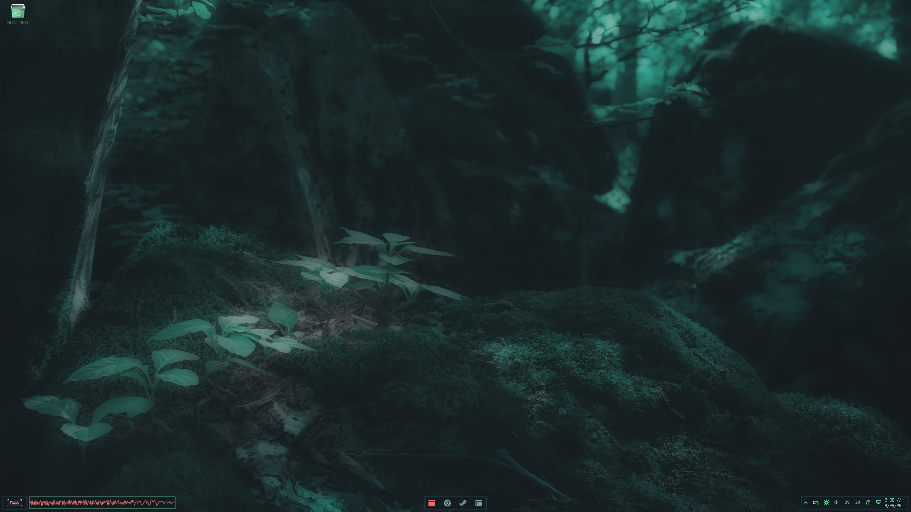

| | |
|---|---|
| 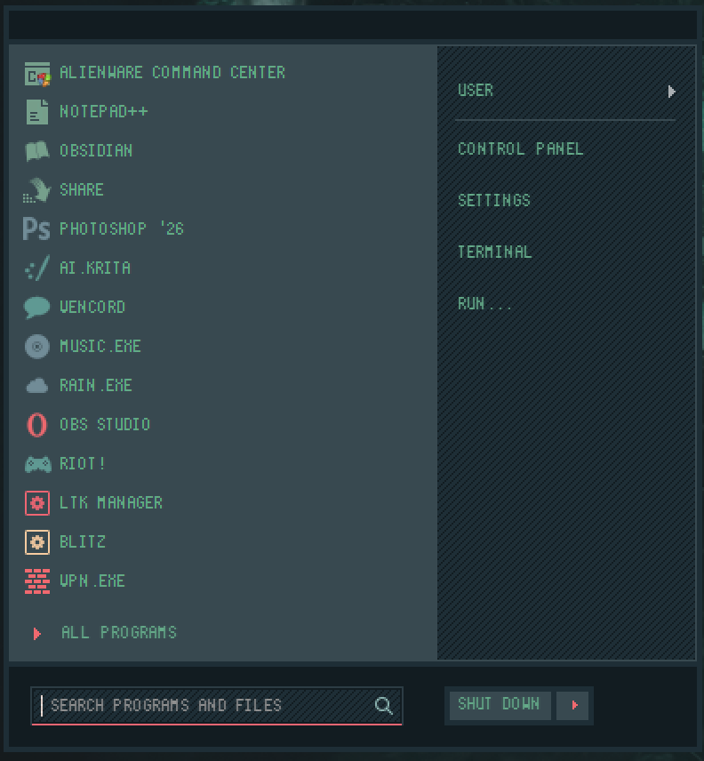 | 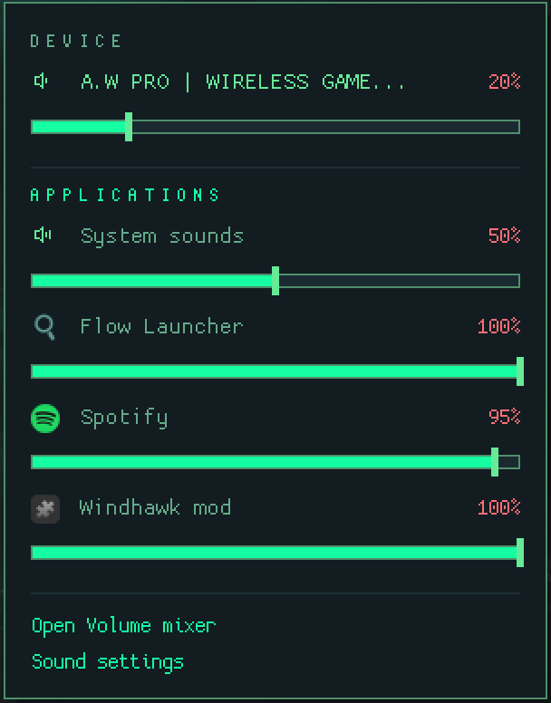 |
| 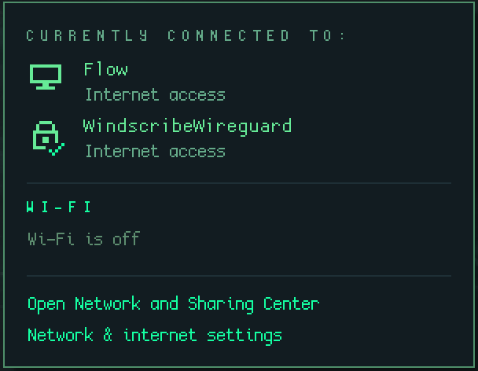 | 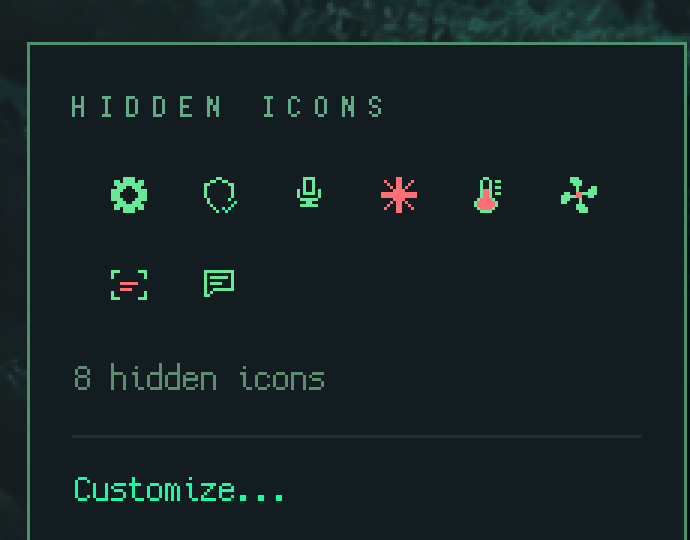 |
| 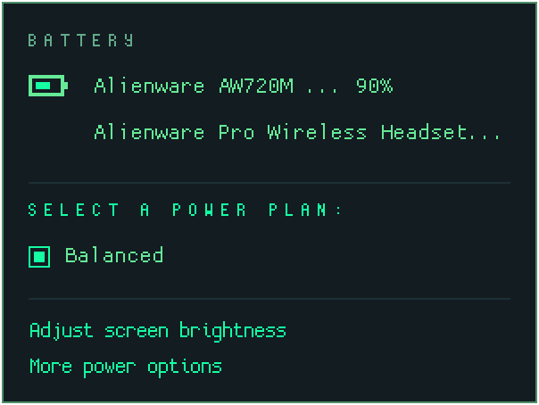 | 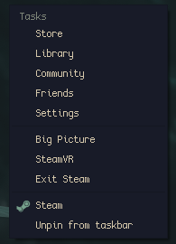 |
| 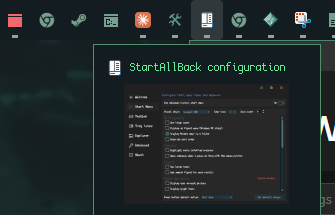 | 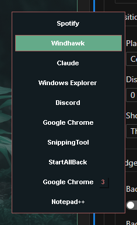 |
| 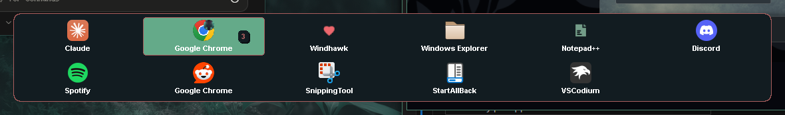 | 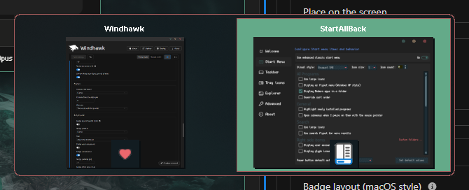 |

More in [`images/`](images/): the taskbar, the orb with Tourne'Table, the StartAllBack theme reader, the light switcher. There's also a [tour of the settings](images/tourne-suite-settings-tour.mp4) (video).

**Taskbar (test)** runs beside StartAllBack's taskbar while it's tested: pinned
apps, grouping in the same order as StartAllBack, jump lists (right-click; the
app's own Windows menu on right-clicking it there), live window previews, the
tray with every icon, the clock, and segments. Its visual style and orb follow
StartAllBack's unless you pick others.

**Switcher (Alt+Tab)** replaces Simple Window Switcher, with all its settings.
Its colours start as Simple Window Switcher's if you've used it, otherwise
your visual style's. Turn Simple Window Switcher off while it's on.

**Tweaks** starts from this PC's settings, so turning it on changes nothing.
Changes for your account apply straight away. Machine-wide ones go into one
step that asks for admin once per save; if you decline, they wait for the next
save.

Icon themes picked in Icon Redirect are downloaded by Windhawk's own process,
once each; its settings start as Resource Redirect's.

A problem in System Icons can no longer take Explorer down, and its icons come
back by themselves when Explorer restarts.

The **Explorer relay** does the two jobs that have to happen inside Explorer:
it passes right clicks on network, volume and battery to the system icons they
stand in for, and it sends scrolling and middle clicks over the volume icon to
the System Icons process.

Because the icons now belong to a different program, Windows treats them as new
tray icons: turn them on again in **Settings > Personalization > Taskbar >
Other system tray icons**, where they're listed as Windhawk.

Turn off Tourne'Suite, the split test build, the separate Tourne mods and
Resource Redirect while this build is on.
