# Tourne'Table media

Everything I've recorded or captured of Tourne'Table, in one place. The mod's readme uses the numbered GIFs straight from here, so they keep their names.

## Showcase

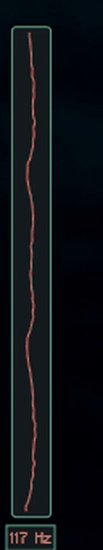

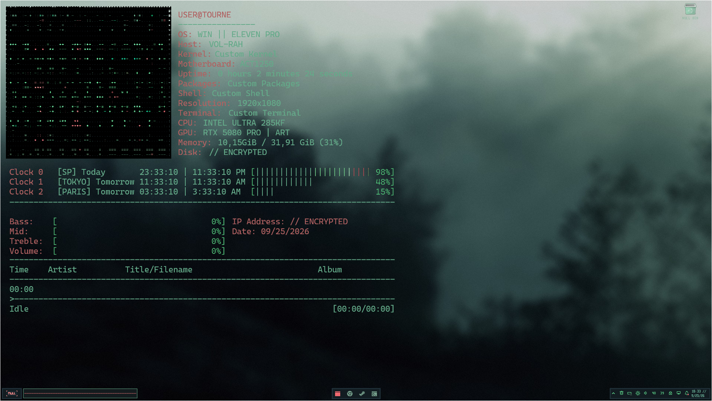

A still at 1080p is in [`showcase/tourne-still-1080p.png`](showcase/tourne-still-1080p.png), and a short [showcase video](showcase/tourne-showcase.mp4).

## More GIFs

| | |
|---|---|
| 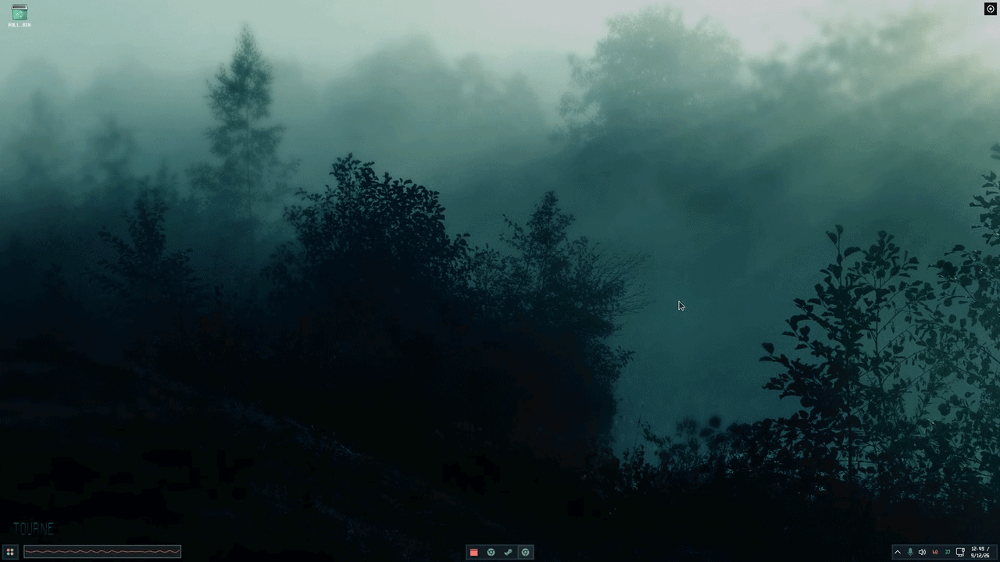 | 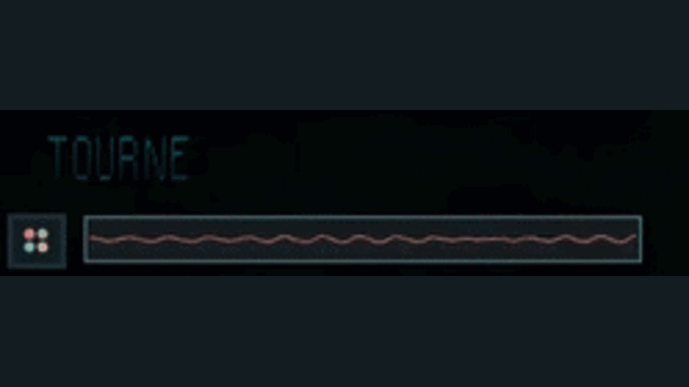 |
| 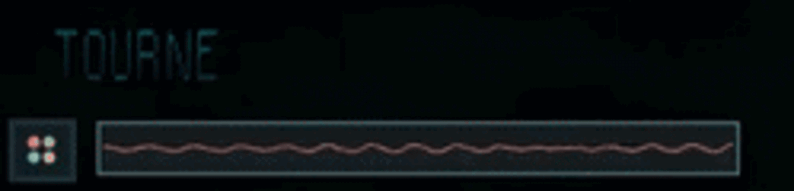 | 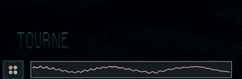 |

## Screens

| | |
|---|---|
| 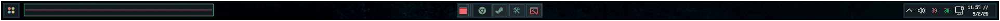 | 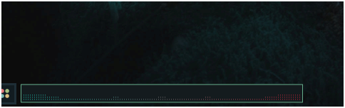 |
| 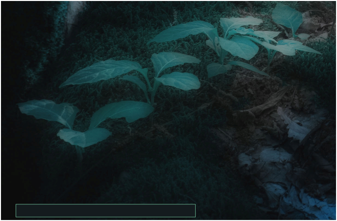 | 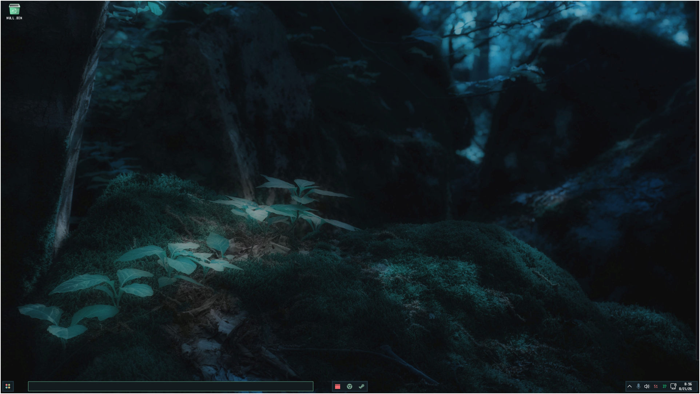 |
| 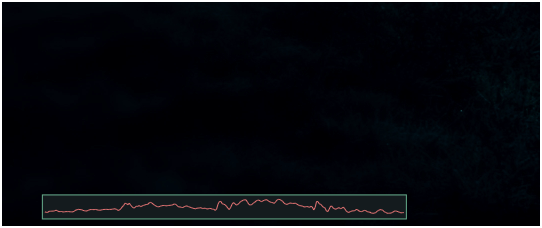 | 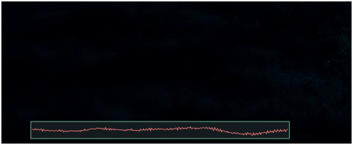 |
| 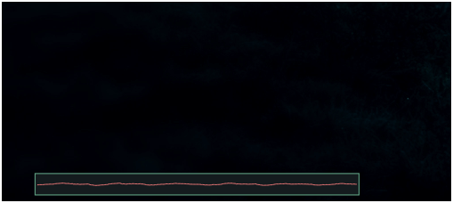 | |

## Features up close

| | |
|---|---|
| 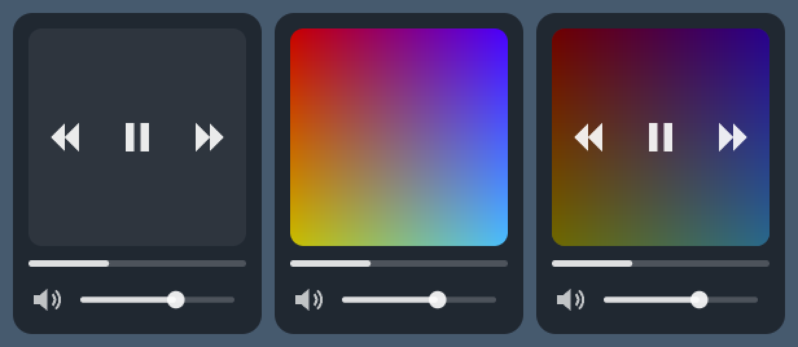 | 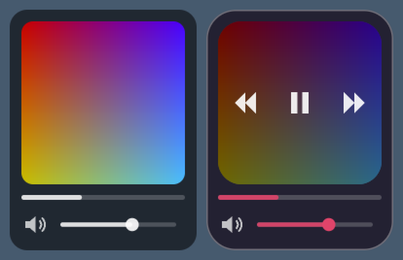 |
| 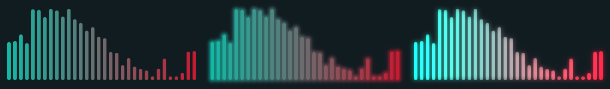 | 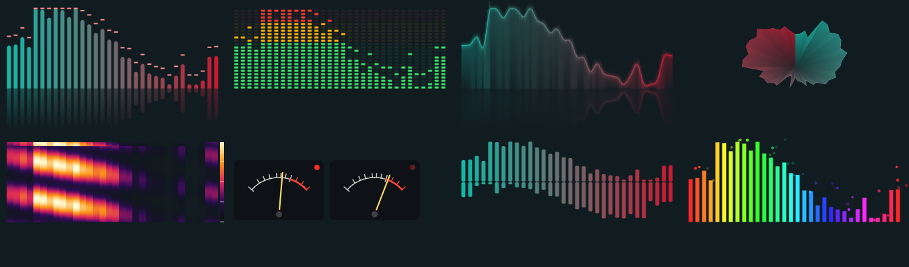 |

The header is also here as a vector, [`tourne-header.svg`](tourne-header.svg).
